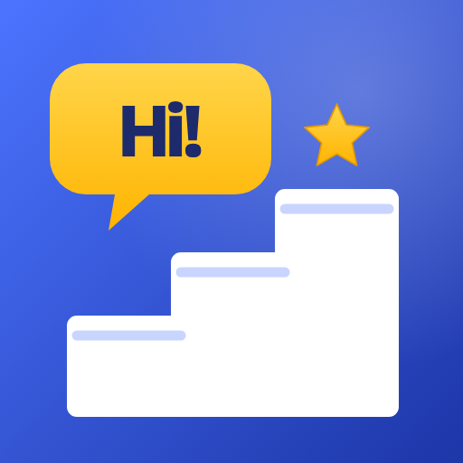

# Paso a Paso English

App para aprender inglés desde cero (nivel A1), al estilo de las apps de lecciones cortas: camino de lecciones, vidas, XP, racha diaria y meta diaria.

## Contenido
- 10 unidades: Saludos, Preséntate, Números, Colores, Familia, Comida, Días y tiempo, Verbos básicos, En la ciudad, Frases útiles.
- 3 lecciones por unidad (Palabras, Frases, Repaso): 30 lecciones.
- Ejercicios: elegir imagen, traducir (opción múltiple), escuchar y elegir, armar frases con fichas, completar la frase, escribir en inglés, unir parejas.
- Pronunciación en inglés con la voz del iPhone (botón de altavoz y modo lento).
- Sección Practicar: repasar errores, práctica rápida, entrenar el oído y lista de palabras.

## Instalar en el iPhone
1. Publica `index.html` en cualquier hosting estático (por ejemplo GitHub Pages) o abre el enlace del artifact.
2. Ábrelo en **Safari**.
3. Toca **Compartir** → **Agregar a inicio**.

Al agregarla a inicio aparece con su propio ícono y se abre a pantalla completa, como una app.

## Progreso
- Se guarda automáticamente en el teléfono cada vez que respondes un ejercicio.
- En **Perfil → Tu progreso guardado** puedes sacar un **código de respaldo** (guárdalo en Notas o envíatelo) y **restaurarlo** si cambias de teléfono o borras los datos de Safari.
